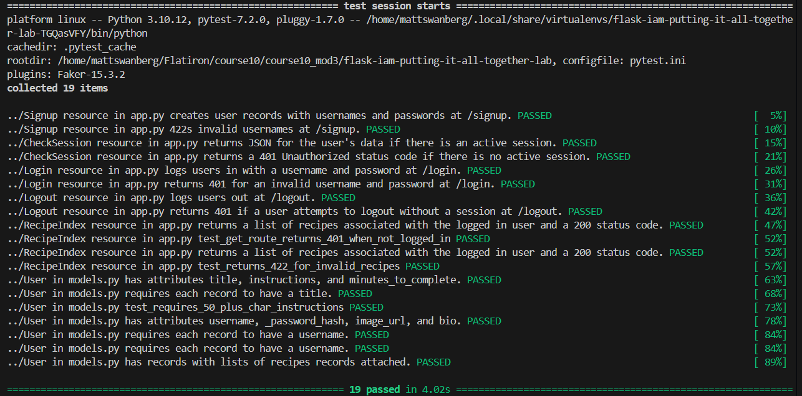

# Lab: Identity and Access Management (IAM)- Full Access

## Project Overview

This project is a full-stack recipe management application built with a Flask REST API backend and a React frontend.

The application implements session-based authentication and authorization, allowing users to register accounts, log in, maintain authenticated sessions, log out, view recipes, and create new recipes.

The backend uses SQLAlchemy for database management, Flask-Bcrypt for password security, Marshmallow for JSON serialization, and Flask-RESTful for API routing.

This project was completed as part of the Flatiron School curriculum.

## Features

### User Authentication

- Register new users with unique usernames
- Securely hash passwords using bcrypt
- Authenticate users using their username and password
- Maintain authenticated sessions using Flask sessions and cookies
- Automatically verify existing sessions
- Log users out by removing their session information
- Restrict recipe endpoints to authenticated users

### Recipe Management

- Retrieve all recipes from the database
- Create recipes associated with the authenticated user
- Include recipe author information in API responses
- Validate recipe titles, instructions, and completion times
- Return appropriate HTTP status codes for successful and unsuccessful requests

### Data Validation

- Require unique, non-empty usernames
- Require non-empty passwords during registration
- Require recipe titles to contain non-whitespace text
- Require recipe instructions to contain at least 50 characters
- Require recipe completion times to be positive integers
- Enforce positive completion times through a database constraint

## Technologies Used

### Backend

- Python
- Flask
- Flask-RESTful
- Flask-SQLAlchemy
- Flask-Migrate
- Flask-Bcrypt
- SQLAlchemy
- Marshmallow
- SQLite

### Frontend

- React
- JavaScript
- HTML
- CSS

### Development and Testing

- Pipenv
- pytest
- curl
- Git and GitHub

## Project Structure

The primary project files are organized as follows:

```text
.
├── client/
│   └── React frontend application
├── server/
│   ├── app.py
│   ├── config.py
│   ├── models.py
│   ├── seed.py
│   └── migrations/
├── testing/
│   ├── app_testing/
│   └── models_testing/
├── Pipfile
├── Pipfile.lock
├── README.md
└── test_suite.png
```

### Important Files

| File | Description |
|------|-------------|
| `server/app.py` | Defines authentication and recipe API resources |
| `server/config.py` | Configures the Flask application and extensions |
| `server/models.py` | Defines database models, relationships, validators, and schemas |
| `server/seed.py` | Populates the database with sample users and recipes |
| `server/migrations/` | Contains Alembic database migration history |
| `testing/` | Contains automated application and model tests |
| `client/` | Contains the React frontend |
| `test_suite.png` | Screenshot of the successful automated test suite |

## Installation and Setup

### 1. Clone the Repository

Clone your project repository and navigate into the project directory.

```bash
git clone https://github.com/Matt20Swanberg/flask-iam-putting-it-all-together-lab
cd flask-iam-putting-it-all-together-lab
```

### 2. Install Backend Dependencies

From the project root directory:

```bash
pipenv install
pipenv shell
```

### 3. Install Frontend Dependencies

```bash
npm install --prefix client
```

### 4. Set Up the Database

Navigate into the server directory:

```bash
cd server
```

Apply the existing database migrations:

```bash
flask db upgrade head
```

The migration history creates the required database tables, relationships, and constraints.

Note: The repository already includes the migration files, so running `flask db init` again is not necessary.

### 5. Seed the Database

From the `server/` directory:

```bash
python seed.py
```

This populates the database with sample users and recipes.

### 6. Start the Flask Backend

From the `server/` directory:

```bash
python app.py
```

The backend runs at:

```text
http://127.0.0.1:5555
```

### 7. Start the React Frontend

Open another terminal and navigate to the project root directory.

```bash
npm start --prefix client
```

The React application can then communicate with the Flask backend.

## Database Models

The application contains two primary SQLAlchemy models: `User` and `Recipe`.

### User Model

The `User` model stores account and profile information.

| Attribute | Type | Description |
|-----------|------|-------------|
| `id` | Integer | Primary key |
| `username` | String | Required, unique username |
| `_password_hash` | String | Stored bcrypt password hash |
| `image_url` | String | Optional profile image URL |
| `bio` | String | Optional user biography |

#### User Validations

- Username must be a string
- Username cannot be empty or contain only whitespace
- Username must be unique
- Password must be a non-empty string during registration

#### Password Security

Passwords are never stored as plaintext.

The `password_hash` setter generates a bcrypt hash before storing it in `_password_hash`.

Attempting to access the `password_hash` property raises an `AttributeError`.

The `authenticate()` method compares a provided password against the stored hash using bcrypt.

### Recipe Model

The `Recipe` model stores recipes created by application users.

| Attribute | Type | Description |
|-----------|------|-------------|
| `id` | Integer | Primary key |
| `title` | String | Required recipe title |
| `instructions` | String | Required instructions with a minimum length of 50 characters |
| `minutes_to_complete` | Integer | Required positive completion time |
| `user_id` | Integer | Foreign key referencing the user |

#### Recipe Validations

- Title must be a non-empty string
- Instructions must be a non-empty string
- Instructions must contain at least 50 characters after trimming surrounding whitespace
- Completion time must be an integer
- Completion time must be greater than zero

A SQLAlchemy `CheckConstraint` provides additional database-level validation:

```python
db.CheckConstraint(
    'minutes_to_complete > 0',
    name='check_positive_minutes'
)
```

### Model Relationships

The application implements a one-to-many relationship between users and recipes.

- One user can have multiple recipes
- Each recipe can be associated with one user
- The `User.recipes` relationship provides access to a user's recipes
- The `Recipe.user` relationship provides access to the associated user

The `user_id` foreign key is nullable in the database model to maintain compatibility with the provided model tests.

However, recipes created through the authenticated `POST /recipes` endpoint are associated with the currently logged-in user.

## Marshmallow Serialization

Marshmallow schemas convert SQLAlchemy model instances into JSON-compatible data.

### UserSchema

Serializes:

- `id`
- `username`
- `image_url`
- `bio`

Password hashes are excluded from serialized responses.

### RecipeSchema

Serializes:

- `id`
- `title`
- `instructions`
- `minutes_to_complete`
- `user`

The `user` field uses a nested `UserSchema`, allowing recipe responses to include information about the recipe's author.

## Authentication and Session Management

The application uses Flask sessions and cookies to maintain user authentication.

### Registration

When a user registers successfully:

1. The request data is validated
2. A new user is created
3. The password is hashed using bcrypt
4. The user is saved to the database
5. The user's ID is stored in the Flask session
6. The serialized user is returned

### Login

When a user logs in:

1. The username is used to retrieve the matching user
2. The password is verified against the stored bcrypt hash
3. The user's ID is saved in the session
4. The serialized user is returned

### Session Verification

The `/check_session` endpoint checks whether a valid user ID exists in the current session.

If a valid authenticated user is found, the endpoint returns their serialized information.

Otherwise, it returns HTTP `401 Unauthorized`.

### Logout

The `/logout` endpoint removes `user_id` from the session.

A successful logout returns HTTP `204 No Content`.

### Protected Routes

Both recipe endpoints require an authenticated session.

Unauthenticated requests receive HTTP `401 Unauthorized`.

When creating recipes, the user ID is retrieved from the authenticated session rather than from client-provided recipe data.

## API Endpoints

All endpoints are served from:

```text
http://127.0.0.1:5555
```

| Method | Endpoint | Description | Success | Error |
|--------|----------|-------------|---------|-------|
| POST | `/signup` | Register a new user | 201 | 422 |
| GET | `/check_session` | Verify the current session | 200 | 401 |
| POST | `/login` | Authenticate a user | 200 | 401 |
| DELETE | `/logout` | End an authenticated session | 204 | 401 |
| GET | `/recipes` | Retrieve all recipes | 200 | 401 |
| POST | `/recipes` | Create a new recipe | 201 | 401, 422 |

### POST /signup

Creates a new user and establishes an authenticated session.

Example request:

```bash
curl -i -c cookies.txt \
  -X POST http://127.0.0.1:5555/signup \
  -H "Content-Type: application/json" \
  -d '{
    "username": "recipe_user",
    "password": "securepassword123",
    "image_url": "https://example.com/profile.png",
    "bio": "I enjoy creating homemade recipes"
  }'
```

Successful response:

```json
{
  "id": 1,
  "username": "recipe_user",
  "image_url": "https://example.com/profile.png",
  "bio": "I enjoy creating homemade recipes"
}
```

HTTP status: `201 Created`

Invalid registration data returns HTTP `422 Unprocessable Entity`.

### GET /check_session

Returns the currently authenticated user's information.

Example request:

```bash
curl -i -b cookies.txt \
  http://127.0.0.1:5555/check_session
```

HTTP status: `200 OK`

Unauthenticated requests return:

```json
{
  "message": "Unauthorized access"
}
```

HTTP status: `401 Unauthorized`

### POST /login

Authenticates a user using their username and password.

Example request:

```bash
curl -i -c cookies.txt \
  -X POST http://127.0.0.1:5555/login \
  -H "Content-Type: application/json" \
  -d '{
    "username": "recipe_user",
    "password": "securepassword123"
  }'
```

Successful authentication returns the serialized user.

HTTP status: `200 OK`

Invalid credentials return:

```json
{
  "message": "Invalid username or password"
}
```

HTTP status: `401 Unauthorized`

### DELETE /logout

Removes the authenticated user's ID from the session.

Example request:

```bash
curl -i -b cookies.txt \
  -X DELETE http://127.0.0.1:5555/logout
```

Successful response:

```text
HTTP/1.1 204 NO CONTENT
```

Requests without an authenticated session return HTTP `401 Unauthorized`.

### GET /recipes

Returns all recipes with nested user information.

Authentication is required.

Example request:

```bash
curl -i -b cookies.txt \
  http://127.0.0.1:5555/recipes
```

Example response:

```json
[
  {
    "id": 1,
    "title": "Homemade Pancakes",
    "instructions": "Combine flour, eggs, milk, and baking powder in a bowl. Mix until smooth, then cook on a heated skillet until golden brown.",
    "minutes_to_complete": 20,
    "user": {
      "id": 1,
      "username": "recipe_user",
      "image_url": "https://example.com/profile.png",
      "bio": "I enjoy creating homemade recipes"
    }
  }
]
```

HTTP status: `200 OK`

Unauthenticated requests return HTTP `401 Unauthorized`.

### POST /recipes

Creates a new recipe associated with the authenticated user.

Example request:

```bash
curl -i -b cookies.txt \
  -X POST http://127.0.0.1:5555/recipes \
  -H "Content-Type: application/json" \
  -d '{
    "title": "Homemade Pancakes",
    "instructions": "Combine flour, eggs, milk, and baking powder in a bowl. Mix until smooth, then cook on a heated skillet until golden brown.",
    "minutes_to_complete": 20
  }'
```

Successful responses contain the newly created recipe and its associated user information.

HTTP status: `201 Created`

Invalid recipe data returns HTTP `422 Unprocessable Entity`.

Example validation error:

```json
{
  "message": "Instructions must be at least 50 characters"
}
```

Unauthenticated requests return:

```json
{
  "message": "User not authenticated"
}
```

HTTP status: `401 Unauthorized`

## Error Handling

The API uses HTTP status codes to communicate the result of each request.

| Status Code | Meaning | Usage |
|-------------|---------|-------|
| 200 | OK | Successful login, session verification, or recipe retrieval |
| 201 | Created | Successful user registration or recipe creation |
| 204 | No Content | Successful logout |
| 401 | Unauthorized | Missing authentication or invalid login credentials |
| 422 | Unprocessable Entity | Invalid registration or recipe information |

### Database Error Handling

The application uses `try` and `except` blocks to handle validation and database errors.

`ValueError` exceptions are raised by model validators when invalid data is provided.

`IntegrityError` exceptions are handled when database constraints are violated during creation.

When either exception is caught during user registration or recipe creation, the application calls:

```python
db.session.rollback()
```

This resets the failed transaction and allows the API to return an appropriate error response.

## Testing

The project includes automated tests for the database models and Flask API endpoints.

### Run the Full Test Suite

From the project root directory:

```bash
pytest -v
```

The `-v` option displays individual test results.

All automated tests passed after completing the implementation.

### Run Model Tests

```bash
pytest testing/models_testing/
```

### Run Specific API Tests

Examples:

```bash
pytest testing/app_testing/app_test.py::TestCheckSession
```

```bash
pytest testing/app_testing/app_test.py::TestLogin
```

```bash
pytest testing/app_testing/app_test.py::TestLogout
```

### Manual API Testing

The API was also tested using `curl`.

Manual testing included:

- Successful user registration
- Duplicate username validation
- Missing or whitespace-only password validation
- Session verification with and without authentication
- Successful login
- Invalid login credentials
- Successful logout
- Unauthorized logout attempts
- Authenticated recipe retrieval
- Unauthorized recipe retrieval
- Successful recipe creation
- Invalid recipe instruction validation
- Unauthorized recipe creation

## Screenshots

### Automated Test Suite

The following screenshot shows the successful execution of the project's automated tests.



## Key Learning Outcomes

This project provided practical experience with:

- Building RESTful APIs using Flask-RESTful
- Implementing session-based authentication
- Managing authentication cookies
- Hashing and verifying passwords using bcrypt
- Creating SQLAlchemy models and relationships
- Implementing model-level and database-level validation
- Managing database migrations with Flask-Migrate
- Serializing related models using Marshmallow
- Protecting API endpoints from unauthorized requests
- Handling database errors and rolling back transactions
- Testing API functionality using pytest and curl
- Maintaining readable and documented Python code

## Author

Created by Matthew Swanberg as part of Course 10 Module 3 (Lab: Identity and Access Management (IAM)- Full Access)